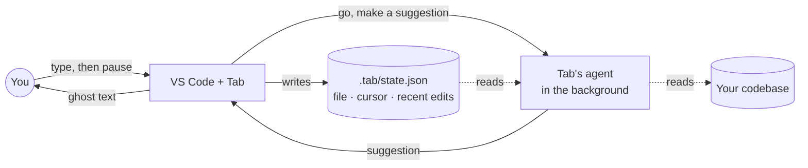
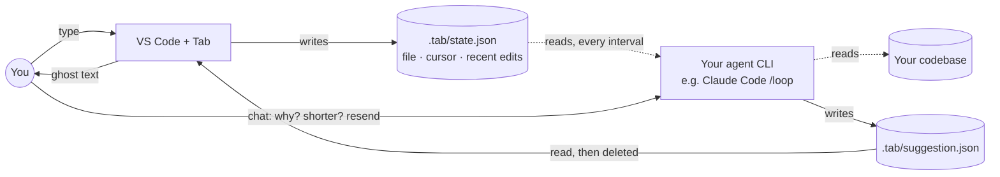

# ✨ Tab

👻 **Ghost-text suggestions in VS Code, powered by the coding agent you already use.**

Tab runs Claude Code or Codex in the background. When you pause, the agent reads your
project and suggests what comes next, right at the cursor. Press **Tab** to accept.

- **Code and prose:** functions, tests, docs, READMEs
- **Effort levels:** finish the line, the block, or the whole file, or let the agent decide (Auto)
- **Looks around first:** the agent reads related files, not just the one you're in
- **Read-only:** the agent never edits your files
- **Your own agent:** uses your installed CLI and login, no extra account

## Two suggestion loops

Either way, an agent CLI reads your codebase and cursor, and suggests at the cursor.

| | Internal | External |
|---|---|---|
| Who suggests | Tab's own agent | an agent CLI you run (Claude Code, Codex, …) |
| When | every time you pause typing | on an interval (e.g. every minute), or on demand |
| Reads the codebase + cursor | ✅ | ✅ |
| You can talk to it while it works | ❌ | ✅ chat in the same session to steer the next suggestion |

### Internal mode · automatic (default)



Nothing to set up: pause typing (or press `Ctrl+Alt+Space`) and the suggestion appears.

### External mode · you stay in the loop



1. Switch the mode to **External** (status bar → Mode).
2. Copy [`assets/SKILL.md`](assets/SKILL.md) into your project.
3. Run your agent in a loop:

```bash
# Claude Code: copy the skill to .claude/skills/tab-suggest/SKILL.md, then (1 minute minimum)
/loop 1m /tab-suggest

# Codex (no built-in loop; each run starts fresh, so no chatting in between)
while true; do codex exec "follow SKILL.md"; sleep 3; done
```

To stop: ask Claude to cancel its loop, or `Ctrl+C` the Codex loop. Each run uses your agent's
quota, even when nothing changed.

#### On demand · no loop needed

You don't have to run a loop. Call the skill once and say what you want, right where your
cursor is:

```bash
/tab-suggest give me a skeleton of this module, no full code
/tab-suggest write example code here
```

The answer shows up as ghost text at your cursor. Press **Tab** to accept it. It's like chatting
with the agent, but the reply lands straight in your file.

## Requirements

- VS Code 1.90+ on Linux
- [Claude Code](https://code.claude.com) or [Codex](https://github.com/openai/codex), installed and logged in
- [Bun](https://bun.sh) to build

## Install

Tab isn't on the Marketplace yet. Build it and install the `.vsix`:

```bash
git clone https://github.com/locchh/tab && cd tab
bun install
bun run package
code --install-extension tab-0.0.3.vsix
```

Reload VS Code and look for **✨ Tab: Low** in the status bar.

## Use

| To | Do |
|---|---|
| Get a suggestion | Stop typing for 2 s, or press `Ctrl+Alt+Space` |
| Accept it | `Tab` |
| Dismiss it | Keep typing |
| Change effort, agent or timing | Click **Tab** in the status bar |
| See what's happening | View → Output → **Tab** |
| Switch mode (Paused / Internal / External) | Click **Tab** in the status bar → Mode |

| Effort | What it writes |
|---|---|
| Low | The rest of the line or sentence |
| Medium | The rest of the function, paragraph or section |
| High | The whole file or document |
| Auto | Whatever the spot needs: the agent decides |

## Good to know

- Tab writes what you're doing to `.tab/state.json` in your project (ignored by git
  automatically). The agent reads it from there.
- The agent may read any file in your workspace, the same as when you run it yourself.
- Each suggestion uses your agent's quota.

## More

- [How it works](docs/HOW_IT_WORKS.md) · [Design](docs/SKETCH.md) · [Development](docs/DEVELOPMENT.md)
- [Changelog](CHANGELOG.md) · [Backlog](docs/BACKLOG.md)

MIT License
