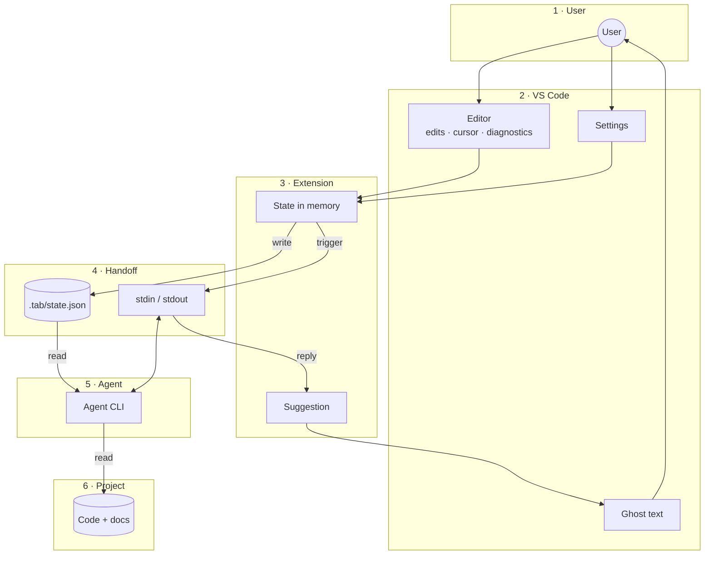

# Data

All the data in Tab: where it lives, who writes and reads it, and how it moves.
Shapes of the State and the Reply: [SKETCH.md › State](SKETCH.md#state), [SKETCH.md › Reply](SKETCH.md#reply).

## Inventory

| Data | Lives in | Written by | Read by | When |
|---|---|---|---|---|
| State | Memory + `.tab/state.json` | Extension | Agent | Every sync interval and right before each trigger |
| Trigger message | Agent's stdin | Extension | Agent | On each trigger |
| Reply | Agent's stdout | Agent | Extension | End of each turn |
| Suggestion | Memory | Extension | VS Code | Until accepted or stale |
| Settings | VS Code config | User | Extension | On change |
| Session ID | Memory | Extension | Extension | To resume after sleep. Lost on VS Code restart, which starts a fresh session. |
| Logs | Output channel "Tab" | Extension | User | Always |

## Dataflow



| Layer | What's in it |
|---|---|
| 1 · User | Types, sets settings, sees ghost text |
| 2 · VS Code | Editor events, settings, showing ghost text |
| 3 · Extension | Holds the State and the suggestion |
| 4 · Handoff | How the extension and agent talk: the State file, and stdin/stdout |
| 5 · Agent | Thinks |
| 6 · Project | What the agent reads |

Data goes down from the user to the agent; the reply comes back up. Logs and the session ID
are left out of the diagram (see Inventory).

1. The user types; VS Code events update the State in memory.
2. The State is written to `.tab/state.json` every sync interval, and once more right before a trigger.
3. The trigger message goes to the agent over stdin.
4. The agent reads the State file and the project.
5. The reply comes back over stdout and becomes a suggestion in memory.
6. If `docVersion` still matches, the suggestion shows as ghost text. Tab inserts it, which is
   an edit, so it flows back into the State as `lastChange`.

## Trigger message

A fixed line, the same every time:

```
go, make a suggestion now
```

Everything else (effort, file, cursor) is already in the State. The instructions, given at
launch, tell the agent to read `.tab/state.json` when it gets this message.
