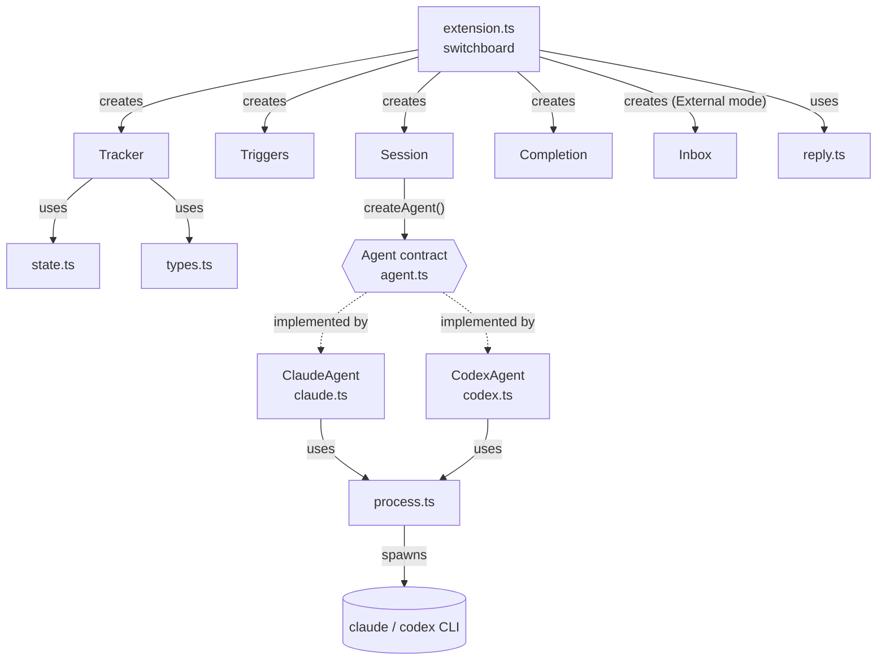
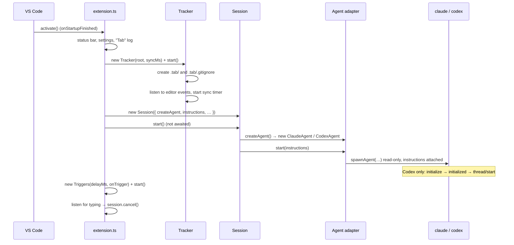
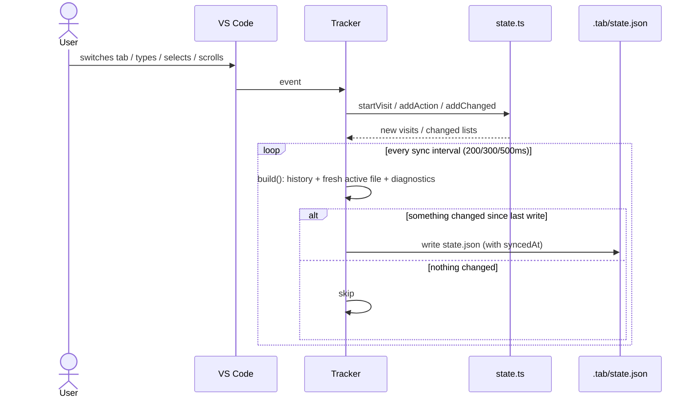
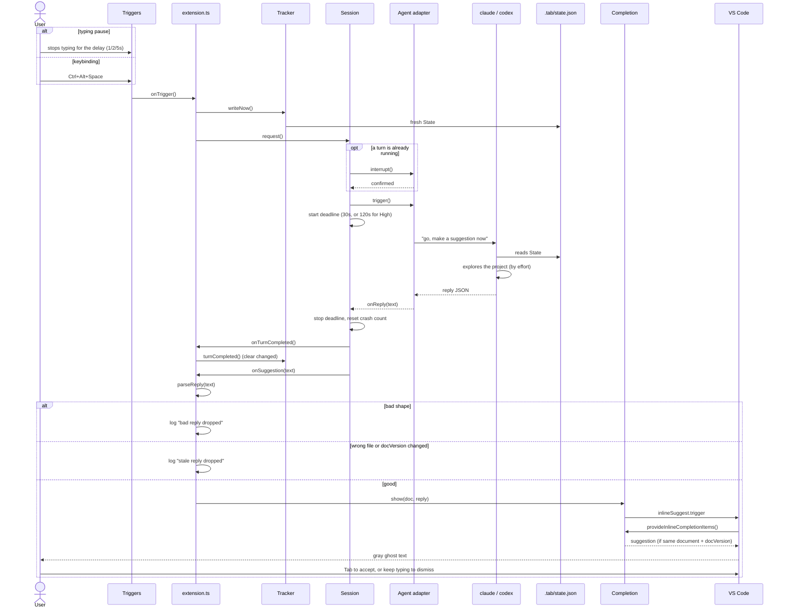
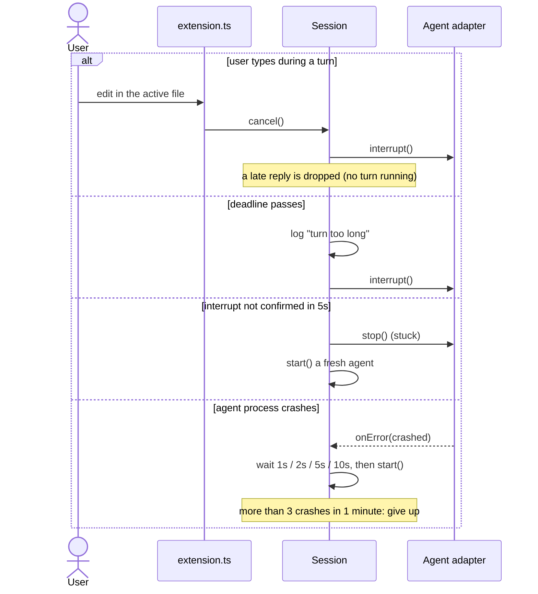
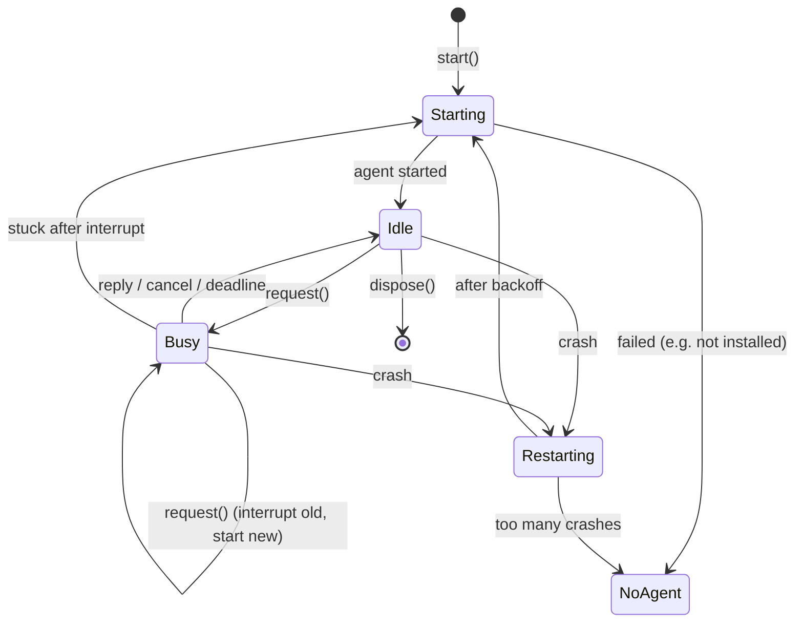
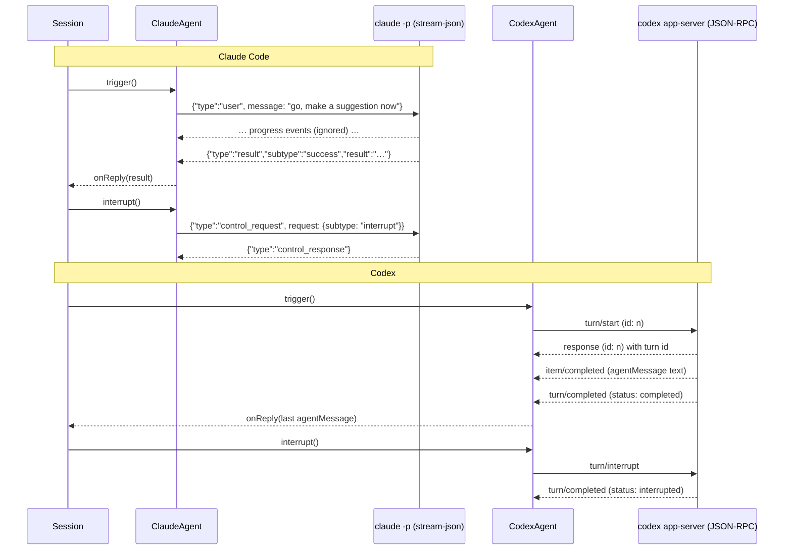

# How It Works

How the code in `src/` fits together, from the moment VS Code starts Tab to a reply coming back.
For the why behind it, see [SKETCH.md](SKETCH.md). For the file list, see [DESIGN.md](DESIGN.md).

## Who does what

| File | Job | Imports `vscode`? |
|---|---|---|
| `extension.ts` | The switchboard: creates everything and connects them | Yes |
| `tracker.ts` | Listens to the editor, keeps history, writes `.tab/state.json` | Yes |
| `state.ts` | Pure State logic (1-based positions, visits, `changed`) | No |
| `types.ts` | Shapes of the State | No |
| `triggers.ts` | Decides *when* to ask: typing pause or keybinding | Yes |
| `session.ts` | Keeps one agent alive, runs one turn at a time | No |
| `reply.ts` | Checks the agent's reply: right shape, still fresh | No |
| `completion.ts` | Shows the checked suggestion as ghost text | Yes |
| `inbox.ts` | External mode: reads `.tab/suggestion.json`, deletes it, passes it on | Yes |
| `agents/agent.ts` | The contract every agent follows | No |
| `agents/claude.ts` | Talks to Claude Code (JSON lines) | No |
| `agents/codex.ts` | Talks to Codex (JSON-RPC) | No |
| `agents/process.ts` | Shared plumbing: spawn, read lines, write, stop | No |
| `instructions.md` | The prompt the agent gets at launch (bundled as a string) | — |
| `markdown.d.ts` | Tells TypeScript that `.md` imports are strings | — |

Files without `vscode` can be unit-tested with `bun test`.

## Who creates whom

`extension.ts` creates the main pieces. They never import each other: `extension.ts`
connects them with callbacks.

How they're connected:

| From | Event | To |
|---|---|---|
| Triggers | fires | `tracker.writeNow()`, then `session.request()` |
| Editor | typing in the active file | `session.cancel()` |
| Session | turn completed | `tracker.turnCompleted()` (clears `changed`) |
| Session | needs the deadline | reads `tracker.effort` |
| Session | reply | `parseReply` → `isFresh` → `completion.show()` |

## 1. Startup

## 2. While the user works: keeping the State fresh

The Tracker keeps **history** (visits, changed, lastChange) from events, and reads
**right-now facts** (active file, cursor, diagnostics) only when it writes.

## 3. A trigger becomes a reply

## 4. When things go wrong

## Session states

## Inside the agent adapters

Both follow the same contract. Only the messages differ.

## Shutdown

Everything `extension.ts` creates goes into `context.subscriptions`. When VS Code closes,
it calls `dispose()` on each: the Tracker stops listening and writing, Triggers stops its
timer, and Session stops the agent (close stdin; kill the process group if it doesn't exit
within 3 seconds).
