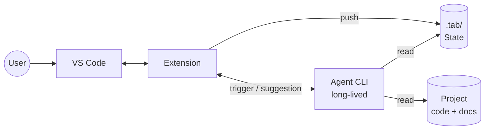
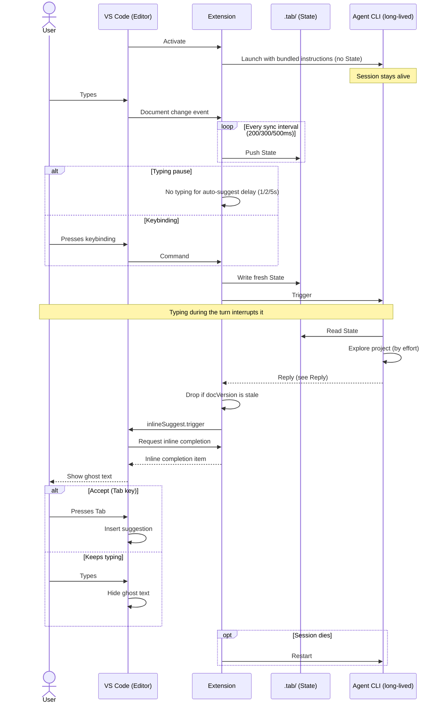
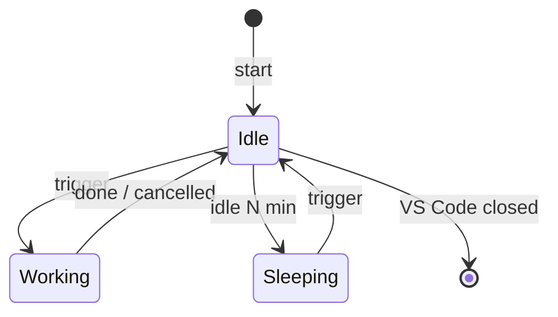
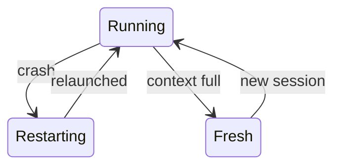

# Sketch

## Features

### Agent-CLI-Backed Ghost Text

Ghost-text suggestions powered by an agent-agnostic CLI coding agent (Claude Code, Codex, etc.), with three effort levels. Suggestions are not limited to code: they also cover writing, such as documentation, READMEs, and other prose.

The agent does not know the project at the start. It explores with its own tools (search, grep, read), and the effort level decides how far it looks:

| Effort | What it's completing | What the agent reads |
|---|---|---|
| **Low** | The current line or sentence | Only the current file |
| **Medium** | A half-written block: a function, component, paragraph, or section | Content related to that block: linked files, references, similar code or writing nearby |
| **High** | A whole file or document | The wider context: the module or folder, sibling files, existing docs, conventions and style used across the project |
| **Auto** | Whatever the spot needs: line, block or file | As much as that needs; the agent decides |

Keeping up with changes:

- On every trigger, the agent reads the current State from `.tab/` (latest change, cursor, file, effort).
- Files listed in the State's `changed` field are re-read instead of trusted from memory.
- Context that is still valid is reused, so later requests stay fast even at higher effort.

Triggers (both always on, at every effort level):

| Trigger | When it fires |
|---|---|
| **Typing pause** | After the user stops typing for the auto-suggest delay (typing, cursor moves, or file switches reset the timer) |
| **Keybinding** | Immediately, when the user presses the keybinding |

A new trigger while a turn is still running interrupts that turn first.

Timing settings (configurable):

| Setting | Options | What it does |
|---|---|---|
| **State sync interval** | 200ms, 300ms, 500ms | How often the extension pushes the current State to `.tab/` |
| **Auto-suggest delay** | 1s, 2s, 5s | How long the user must stop typing before a suggestion fires |

At launch, the agent only receives the instructions. It learns the State only by reading `.tab/` after a trigger. Right before each trigger, the extension writes the State once more, so the agent never reads stale data.

## Components

- **VS Code extension:** Tracks the State, runs the loop, holds the agent session, and shows ghost text. Also configurable.

- **Instructions (Skill or similar):** Bundled in the extension and passed at launch. They cover how to read the State, what to write at each effort level, the reply format, and to never edit files. The agent should focus only on the input and the output: no narration, no chatting, no explanations.

- **Agent CLI:** Reads the project and generates suggestions (read-only). Installed and logged in by the user.

## Requirements

### Functional Requirements

- Ghost text for code and prose
- Four effort levels (Low, Medium, High, Auto)
- Works with any CLI agent
- Read-only agent
- Long-lived session

### Non-Functional Requirements

- Low latency
- Lightweight
- Local state

## Architecture



## Workflow



## State

What the extension knows about the user. Kept in memory and pushed to `.tab/` every State sync interval (200/300/500ms). The agent never receives it directly: it reads `.tab/` after a trigger.

```json
{
  "syncedAt": "2026-10-24T14:32:01.200Z",
  "effort": "medium",
  "active": {
    "file": "docs/guide.md", "language": "markdown", "docVersion": 57,
    "cursor": { "line": 42, "col": 10 }, "selection": null, "dirty": true,
    "text": "# Guide\n...", "lineCount": 87
  },
  "lastChange": {
    "file": "docs/guide.md", "docVersion": 57,
    "start": { "line": 42, "col": 1 }, "end": { "line": 42, "col": 1 },
    "text": "To sign in, "
  },
  "changed": ["src/auth/token.ts", "docs/guide.md"],
  "visits": [
    { "file": "docs/guide.md", "since": "2026-10-24T14:31:58.900Z", "actions": ["edit"] },
    { "file": "src/auth/login.ts", "dwellMs": 2800, "actions": ["select"] }
  ],
  "diagnostics": [
    { "file": "src/auth/login.ts", "line": 45, "severity": "error",
      "message": "Property 'expiry' does not exist on type 'Token'." }
  ]
}
```

| Field         | Meaning                                                                    | How to get it (VS Code API)                                                                                     |
| ------------- | -------------------------------------------------------------------------- | --------------------------------------------------------------------------------------------------------------- |
| `syncedAt`    | When this State was pushed to `.tab/`.                                   | `new Date().toISOString()` at each sync.                                                                        |
| `effort`      | `low`, `medium`, `high` or `auto`.                                         | The extension's own setting, chosen from the status bar.                                                        |
| `active`      | Where the user is now.                                                     | `window.activeTextEditor`; updated on `window.onDidChangeActiveTextEditor`.                                     |
| `.file`       | Path of the active file, relative to the workspace root.                   | `workspace.asRelativePath(editor.document.uri)`                                                                 |
| `.language`   | Language of the active file (code or prose, e.g. `typescript`, `markdown`). | `editor.document.languageId`                                                                                    |
| `.docVersion` | VS Code's version of the document. Goes up on every edit, saved or not.    | `editor.document.version`                                                                                       |
| `.cursor`     | Line and column, 1-based.                                                  | `editor.selection.active` (+1 to line and character); updated on `window.onDidChangeTextEditorSelection`.       |
| `.selection`  | `{ "start": {line, col}, "end": {line, col} }`, or `null`.                 | `editor.selection.start` / `.end` when `!editor.selection.isEmpty`, else `null`.                                |
| `.dirty`      | The file has unsaved changes.                                              | `editor.document.isDirty`; updated on `workspace.onDidChangeTextDocument` and `onDidSaveTextDocument`.          |
| `.text`       | Active file content. Only when `dirty`; otherwise the agent reads disk.    | `editor.document.getText()`                                                                                     |
| `.lineCount`  | Lines in the file. `1` with no content means an empty file.                | `editor.document.lineCount`; empty when `document.getText().trim() === ""`.                                     |
| `lastChange`  | The most recent edit: replaced range (before the edit) and inserted text.  | `workspace.onDidChangeTextDocument` → `event.contentChanges` (`range`, `text`), converted to 1-based.           |
| `changed`     | Files edited, saved, created or deleted since the last completed turn, including outside the editor (e.g. `git pull`). Cleared when a turn completes, so an interrupted turn never loses the list. | `workspace.onDidChangeTextDocument` plus a `workspace.createFileSystemWatcher` for disk changes. |
| `visits`      | Files visited, most recent first. At most 20; a revisit moves the file to the top (actions merged, `dwellMs` added up); deleted files are removed. | The extension's own list: a visit starts and ends on `window.onDidChangeActiveTextEditor`.                      |
| `.since`      | Current visit only: when it started.                                       | Time recorded when the visit starts.                                                                            |
| `.dwellMs`    | Finished visits only: how long the user stayed, in milliseconds.           | `Date.now() - since` when the visit ends.                                                                       |
| `.actions`    | What the user did there: `edit`, `select`, `cursor`, `scroll`.             | `edit`: `workspace.onDidChangeTextDocument`. `select`: `onDidChangeTextEditorSelection` with a non-empty selection. `cursor`: same event, empty selection. `scroll`: `window.onDidChangeTextEditorVisibleRanges`. |
| `diagnostics` | Errors in workspace files, at most 50. Warnings are left out.              | `languages.getDiagnostics(uri)`; updated on `languages.onDidChangeDiagnostics`. `range.start.line + 1`, `severity` from `DiagnosticSeverity`. |

Rules:

- Raw facts only. The agent works out meaning (enclosing function or section, what's missing).
- The extension writes `.tab/`; the agent only reads it.
- The State is written on every sync interval and once more right before each trigger.
- The agent reuses files it read in earlier turns, except the active file (always from `active.text` or disk)
  and files in `changed` (re-read before relying on them).
- Visits are weak hints; actions count more. The agent checks that a visited file is
  linked to the work before using it.
- Line and column numbers are 1-based. VS Code's 0-based positions are converted.
- Unsaved text is written for the active file only. Other dirty files are read from disk.
- Each VS Code window has its own State and agent.
- The workspace root is the first workspace folder. Files in other folders are treated as
  outside the workspace.
- No suggestions when there is no active text editor, or the active file is untitled or
  outside the workspace. Focus moving to a terminal or panel keeps the last active file.
- The agent may read any file in the workspace, including `.env`, the same as when the
  user runs it directly.

## Reply

What the agent sends back, as one JSON object and nothing else:

```json
{
  "docVersion": 57,
  "file": "docs/guide.md",
  "start": { "line": 42, "col": 13 }, "end": { "line": 42, "col": 13 },
  "text": "open the app and press Sign in."
}
```

| Field        | Meaning                                                                 |
| ------------ | ----------------------------------------------------------------------- |
| `docVersion` | The `active.docVersion` the agent read from `.tab/`.                    |
| `file`       | The file the suggestion is for.                                         |
| `start`, `end` | Range to replace, 1-based. Same as `start` for a plain insert.        |
| `text`       | The suggestion. Empty string means no suggestion.                       |

Rules:

- The extension drops the reply if `file` is not the active file or `docVersion` is not the
  document's current version. The user has moved on, so the suggestion would land in the wrong place.
- Anything that isn't this shape is a bad reply (see [Errors](#errors)).

## Long-lived agent session

The extension keeps one agent process alive, with no SDK. `claude -p "prompt"` runs once and
exits; stream mode and `codex app-server` keep reading stdin, so each message is a new turn
in the same session. Waiting is free; closing stdin ends it.

Each turn is only a trigger. The agent gets the State by reading `.tab/` (see [State](#state)),
never through the message.

### Lifecycle

| Stage | What the extension does |
|---|---|
| Start | On activation in a trusted workspace with `tab.enabled` (Tab stays off in untrusted folders), launch the agent CLI read-only with the bundled instructions and the flags in the table below. No State is sent. No MCP servers or connectors, since those can change things outside the machine (GitHub, Google Drive). If read-only cannot be set, fail to start. For Codex, also send `initialize`, `initialized` and `thread/start`. |
| Run | Keep stdin open. Send a trigger turn on each trigger (see [Workflow](#workflow)). |
| Crash | If the process exits unexpectedly, launch it again. The next trigger reads the full State from `.tab/`. |
| Context full | A long session fills the agent's context. Start a fresh session; the next trigger reads the full State from `.tab/`. |
| Idle | No State change for N minutes (e.g. 15): close the agent. Status bar shows `Tab: sleeping`. On the next trigger, relaunch and resume the session (`claude --resume <id>` or Codex thread resume), or start fresh. |
| Stop | VS Code closes or a setting changes: `deactivate` closes the agent's stdin and the agent exits cleanly. |
| Orphans | The agent runs in its own process group. If it doesn't exit a few seconds after stdin closes, the extension terminates the group, then kills it. If the extension host dies, the agent's stdin closes and it exits on its own. |

Normal life:



Recovery:



| | Claude Code | Codex |
|---|---|---|
| Start | `claude -p --input-format stream-json --output-format stream-json --verbose` | `codex app-server`, then `initialize`, `initialized`, `thread/start` |
| Read-only | `--tools Read,Grep,Glob --strict-mcp-config` | `--disable apps`, `-c mcp_servers.<name>.enabled=false` for each server in `codex mcp list --json` (name unquoted; quoted names crash app-server), and `thread/start` with `sandbox: "read-only"`, `approvalPolicy: "never"` |
| Instructions | `--append-system-prompt` | `developerInstructions` in `thread/start` |
| Send a trigger | One JSON user message on stdin | One `turn/start` request |
| Reply text | `result` field of the `result` event | `item/completed` with an `agentMessage` item |
| Turn done | `result` event (each turn also starts with an `init` event) | `turn/completed` notification |
| Interrupt | `{"type":"control_request","request_id":"…","request":{"subtype":"interrupt"}}` on stdin; the turn ends with a `result` of subtype `error_during_execution`, which the extension maps to `cancelled` | `turn/interrupt` with `threadId` and `turnId`; `turn/completed` arrives with status `interrupted` |
| Stop | Close stdin | Close stdin |

When a turn is sent and when it is interrupted: [Workflow](#workflow).

## Errors

| Error                                   | Detected by                                     | Action                                                         | Retry                                                                                  |
| --------------------------------------- | ----------------------------------------------- | -------------------------------------------------------------- | -------------------------------------------------------------------------------------- |
| Agent not installed or not logged in    | Check at start; agent fails at start            | Explain how to install or log in. Status `error`.              | No. The user fixes it, then the extension tries again.                                 |
| Login expired mid-session               | Auth error in agent output                      | Same as above.                                                 | No                                                                                     |
| Rate limit                              | Rate-limit error from the agent                 | Pause triggers. Status `waiting`.                              | Yes: after the wait the error gives, or 30 s, 60 s, 120 s                              |
| Quota used up                           | Quota or billing error from the agent           | Stop triggers. Status `error`, tell the user.                  | No. The user acts, then the extension tries again.                                     |
| Turn too long                           | No turn-done event in time (see Deadlines)      | Interrupt the turn; show it as an error, not `cancelled`.      | No. The next trigger starts a new turn.                                                |
| Turn cancelled by the extension         | The user kept typing, or a new trigger arrived  | Drop it quietly.                                               | No                                                                                     |
| Bad reply (not JSON, wrong shape)       | Validation (see [Reply](#reply))                | Drop it. Retry; show an error only if the retry also fails.    | Once, with a reminder of the format. Then wait for the next trigger.                   |
| Agent asks to write or run a command    | Permission or approval request from the agent   | Deny it. Log it.                                               | No                                                                                     |
| Agent process crashes                   | Process exits                                   | Relaunch; the next trigger reads the full State from `.tab/`. | Backoff 1 s, 2 s, 5 s, 10 s. After 3 crashes in 1 minute: stop, status `error`.        |
| Network down                            | Connection error from the agent                 | Pause triggers. Status `offline`.                              | Backoff 5 s, 15 s, 30 s, 60 s, then every 60 s, at most 10 times. Then status `error`. |

Deadlines: time limits so nothing hangs forever. The timer starts when the request is sent.

| What | Deadline | If it's missed |
|---|---|---|
| Low, Medium suggestion | 30 s | Interrupt the turn, status `error` (see "Turn too long") |
| High, Auto suggestion | 120 s | Same. Writing a whole file takes longer. |
| Agent start or resume | 30 s | Treat it as a crash (see "Agent process crashes") |
| Interrupt confirmed | 5 s | The agent is stuck: kill it and relaunch |

Rules:

- Never retry forever; past the limit, show the error in the status bar.
- Failure counts and cooldowns survive State changes and reset only after a successful
  turn, so typing never skips a wait.
- Retry only while still relevant; if the user moved on, handle the new State instead.
- Retries are quiet: only the status bar and the log change until the final outcome.
- Errors stay quiet: status bar plus log. No pop-ups, except for things the user must fix
  (not installed, not logged in).
- Everything is logged to a VS Code output channel named "Tab".
