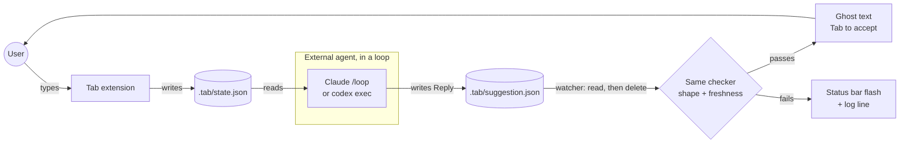

# 001 · CR · Modes

Status: done (v0.0.3)

## Goal

Replace the Pause switch with three modes (from BACKLOG.md):

- **Paused:** no suggestions at all
- **Internal:** Tab's own agent suggests (today's behavior)
- **External:** Tab's agent is stopped; Tab shows suggestions that other tools (e.g. Claude in
  chat, a script) drop into `.tab/suggestion.json`

Both suggestion sources go through the same checker. No "both" mode.

### How External mode works

The agent and Tab never talk directly: they only share two files. Stopping either side stops
the flow.

## Current state

- `package.json`: a boolean setting `tab.enabled` (default `true`) is the pause switch.
- `src/status.ts`: the popup has a "Pause Tab / Resume Tab" row that flips `tab.enabled`;
  the status bar shows `Tab: paused` when it's off.
- `src/extension.ts`:
  - the session and triggers always run; the trigger callback checks `tab.enabled` and skips
    if it's off (`trigger ignored: paused`)
  - turning `tab.enabled` off cancels the running turn, but the agent process keeps running
  - `showReply(text, turn)` checks a reply (`parseReply` → `isFresh`) and shows it via
    `completion.show()`
- `src/tracker.ts` always writes `.tab/state.json`.
- `.tab/.gitignore` (`*`) already keeps any new file in `.tab/` out of git.

## Changes

**`package.json`**
- Remove `tab.enabled`.
- Add `tab.mode`: `"paused" | "internal" | "external"`, default `"internal"`, with descriptions.

**`src/inbox.ts`** (new, ~40 lines, imports vscode)
- `class Inbox`: watches `.tab/suggestion.json` (FileSystemWatcher, create + change).
- On a new file: read it → pass the text to a callback → delete the file, so the same
  suggestion is never shown twice.
- `dispose()` stops the watcher.

**`src/extension.ts`**
- Read `tab.mode` instead of `tab.enabled`.
- A small `applyMode(mode)` that starts/stops pieces:

  | | Paused | Internal | External |
  |---|---|---|---|
  | Session (agent) | stopped | running | stopped |
  | Triggers | off | on | off |
  | Inbox | off | off | on |
  | Tracker | on | on | on |

- Switching modes calls `applyMode` again (dispose what's no longer needed, create what is).
  Leaving Internal stops the agent process (saves quota).
- `showReply` takes a label instead of a turn number: `#5` for internal, `#ext` for external.
- Remove the `tab.enabled` checks.

**`src/status.ts`**
- Replace `setPaused(boolean)` with `setMode(mode)`.
- Status bar: `Tab: paused` / `Tab: Low` (internal, as today) / `$(inbox) Tab: external`.
- Popup: the "Pause Tab" row becomes **Mode** (shows the current one) → Paused / Internal /
  External.

**`assets/SKILL.md`** (new, a plain file in the repo; Tab doesn't touch it)
- A standalone skill for external agents: the same rules as `src/instructions.md`, but the
  Reply JSON is written to `.tab/suggestion.json` (the whole file at once) instead of replied.
  Tab shows it and deletes it; the agent writes the next one on its next run.
- Users copy it into their project by hand, wherever their agent reads it.

**Docs**
- `README.md`: an "External mode" section: copy `assets/SKILL.md`, then loop recipes:
  - Claude Code: `/loop 1m follow SKILL.md` (built-in; about 1 minute minimum)
  - Codex (no built-in loop): `while true; do codex exec "follow SKILL.md"; sleep 3; done`
  - Either, only when something changed: wait on `inotifywait -e close_write .tab/state.json`
    instead of `sleep`, so no quota is spent while you're idle
  - How to stop: Codex loop → `Ctrl+C`; Claude `/loop 1m …` → ask Claude "cancel the Tab
    loop" (`Esc` doesn't stop a fixed-interval loop). Or switch Tab out of External: the
    inbox is then ignored, but the loop keeps spending quota, so stop it too.
- `SKETCH.md`: a short "Modes" section; mention the inbox in Components.
- `DATA.md`: an inventory row for `.tab/suggestion.json` (written by other tools, read by
  Tab, deleted after reading).
- `HOW_IT_WORKS.md`: `inbox.ts` in the file table and the "who creates whom" diagram.
- `README.md`: one line on modes in "Use".
- `BACKLOG.md`: remove the item. `CHANGELOG.md`: add it under the next version.

## Decisions

1. **Paused: keep writing `state.json`?**
   Suggestion: **yes**. It's light, and switching to External gives the other tool fresh
   data right away.
2. **External: should the keybinding do anything?**
   Suggestion: **write `state.json` right away**, so whoever suggests next sees the newest
   state. No agent call.
3. **Old `tab.enabled` users:** the setting just disappears; everyone starts in Internal.
   Fine for now (we're at 0.0.x, no real users yet).
Known limits (not decisions, just facts to keep in mind):
- `assets/SKILL.md` is a copy of the rules in `src/instructions.md`: when one changes, update
  the other by hand.
- External loops are never really "every 3 s": each run is a full agent turn (about 5 s for
  Claude, about 25 s for Codex, plus cold start for `codex exec` / `claude -p`).
- Every loop run costs quota, even when nothing changed. The `inotifywait` recipe avoids that.
- Internal mode stays the fast path.

## References

Loop features of CLI agents (checked 2026-10-25):

- **Claude Code `/loop`:** [Run prompts on a schedule](https://code.claude.com/docs/en/scheduled-tasks)
  - `/loop <interval> <prompt>`, units `s`/`m`/`h`/`d`; seconds are rounded up to a minute
    (cron granularity), so the minimum is **1 minute**.
  - Without an interval, Claude picks a delay between 1 minute and 1 hour each time.
  - Runs only while the session is open and idle; recurring tasks expire after 7 days.
  - A fixed-interval loop is stopped by asking Claude to cancel it; `Esc` stops only a
    self-paced loop.
  - Recurring runs start late by a fixed offset of up to half the interval (jitter); the
    gap between runs stays the same.
- **Codex:** no built-in loop. Use a shell loop around
  [`codex exec`](https://developers.openai.com/codex/noninteractive) (non-interactive mode);
  flags in the [CLI reference](https://developers.openai.com/codex/cli/reference).

## Test

**Unit (`bun test`)**
- Nothing new is pure logic; `reply.ts` tests already cover the checker the inbox reuses.

**Manual (playground: `code --extensionDevelopmentPath=$PWD tmp/playground`)**
1. Internal: type and pause → ghost text, as before.
2. Switch to Paused → typing does nothing; status bar shows `Tab: paused`; log shows the agent
   stopped.
3. Switch to External → status bar `Tab: external`; no agent starts.
   - Read `.tab/state.json`, then write a matching Reply to `.tab/suggestion.json`
     (e.g. ask Claude in chat to do it) → ghost text appears, the file is deleted, log shows
     `#ext shown`.
   - Write one with an old `docVersion` → log `#ext stale reply dropped`, no ghost text.
   - Write invalid JSON → log `#ext bad reply dropped`.
4. External with a real loop:
   - Copy `assets/SKILL.md` into the playground.
   - In a terminal in the playground, run the Codex shell loop → ghost text keeps appearing as
     you type and pause; each suggestion file is deleted after it's shown.
   - In Claude Code, run `/loop 1m follow SKILL.md` → a suggestion about once a minute.
5. Switch back to Internal → `agent started` in the log; typing pause works again.
