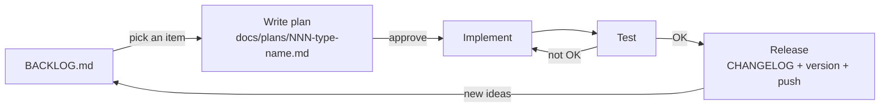

# Plans

How we work after the MVP: every change gets a short written plan before any code.

## The flow



1. **Backlog:** ideas and leftovers go into [BACKLOG.md](../BACKLOG.md).
2. **Pick:** choose one item to work on.
3. **Plan:** write a plan file here, based on the code as it is now.
4. **Approve:** read it, answer its open decisions, set `Status: approved`. No code before this.
5. **Implement:** follow the plan. If it needs to change, update the plan first.
6. **Test:** unit tests + the manual checks the plan lists (playground in `tmp/`).
7. **Release:** remove the item from the backlog, add it to [CHANGELOG.md](../../CHANGELOG.md),
   bump the version, commit, push. Set `Status: done (vX.Y.Z)`.

Plans stay here after they're done, as a record of what changed and why.

## Naming

`NNN-<type>-<short-name>.md`, e.g. `001-cr-modes.md`.

- **NNN:** a running number (001, 002, …), so the order is clear
- **type:** what kind of work it is

| Type | For |
|---|---|
| `cr` | Change request: a new feature or a change in behavior |
| `task` | Work with no behavior change: docs, tests, refactors, setup |
| `bug` | Something that's broken |
| `incident` | Something broke in real use: what happened and how we stop it happening again |

## Status

`draft` → `approved` → `done (vX.Y.Z)`

## Template

Keep it short. Leave out sections that don't apply.

```markdown
# NNN · Type · Name

Status: draft

## Goal
What we want, in one or two lines (usually the backlog item).

## Current state
What the code does today that matters here, with file names.

## Changes
File by file: what gets added or changed.

## Decisions
Open questions to answer before approval.

## Test
How we'll know it works: unit tests and manual steps.
```

For an **incident**, use these sections instead: What happened, Cause, Fix, Prevention.
